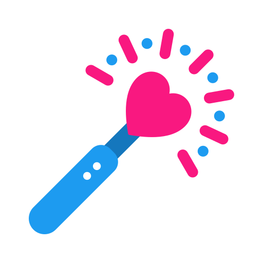

<p align="center"></p>

# vibetwt

*Social media buzz, taken entirely too literally.*

Use an "extra controller" from [Intiface Central](https://intiface.com/central) and
[buttplug.io](https://buttplug.io) to feel every like, retweet and reply your X/Twitter
account gets, deep in your body. vibetwt ("vibe twitter") is an interactive terminal
dashboard, and a sibling of [VibeClaude](https://github.com/transkatgirl/vibeclaude), whose
way of mixing it borrows.

```
X ──Activity API──HTTPS──▶ vibetwt ──WebSocket──▶ Intiface Central ──BLE──▶ you
```

## Requirements

- Node.js 22.12 or newer
- Intiface Central with its WebSocket server running (default `ws://127.0.0.1:12345`)
- An X developer account with pay-per-use credits, and a spending limit you can live with
- A vibration-capable "controller", paired in Intiface Central
- A little desire
- A comfortable, private setting
- Something worth posting (optional, but strongly recommended)

## Install

```bash
npm install
cp .env.example .env
```

Then introduce it to your account:

1. Create an app in the [X Developer Console](https://console.x.com) and enable OAuth 2.0.
2. Add `http://127.0.0.1:8976/callback` as a callback URL.
3. Set a spending limit on the account (see [Cost](#cost)).
4. Put the app's client ID and bearer token in `.env`.
5. Run `npm run login` and approve the app.

`npm run login` prints the address to approve it at, opens it in your browser (on macOS,
Windows, and Linux with a desktop), and waits up to five minutes for your answer. If no
browser appears, open the address yourself. It asks for read access only (`tweet.read`,
`users.read`, `like.read`, and `offline.access` to stay logged in), so vibetwt cannot post,
like or follow as you. Earning the attention is still your job.

## Use

1. Start Intiface Central and press the server start button.
2. Turn your device on.
3. Try the patterns, so that nothing comes as a surprise later:

   ```bash
   npm run try            # all three
   npm run try -- reply   # just one
   ```

4. Run `npm start -- --no-device` once, to see that X events arrive before anything
   vibrates.
5. Run `npm start`.
6. Get comfortable, post something, and wait for the timeline to notice you.

| Command | Description |
|---|---|
| `npm run login` | Connect your X account. |
| `npm start` | Open the dashboard and start listening. |
| `npm start -- --no-device` | Run the dashboard without vibrating. |
| `npm start -- --plain` | Print a simple log instead of the dashboard. |
| `npm run try -- [like\|retweet\|reply]` | Play patterns without X: the ones you name, or all three. |
| `npm run cleanup` | Remove this app's X subscriptions. |

The dashboard's top line says how things stand: `X live`, `X connecting` or
`X reconnecting`, and then your device's name, `scanning for device` or `Intiface offline`.
vibetwt keeps looking for Intiface and scans until a device that can vibrate turns up, so
the order you start things in does not matter. If it stays on `Intiface offline`, start the
server in Intiface Central and check that the port matches `BUTTPLUG_URL`.

Below that are the strength, a meter of what the device is playing right now, the estimated
cost, the filter, and every event as it arrives, newest first. The selected event's details
say what became of it: `played`, `filtered out`, `paused` or `no device`. Nothing is saved
up: an event that arrives while you are paused, or before a device is connected, is listed
but never played later.

| Key | Action |
|---|---|
| `space` | Stop the device immediately and pause, or resume |
| `←` `→` or `-` `+` | Change strength by 5% |
| `q` or `Ctrl+C` | Stop the device and quit (`Ctrl+C` works everywhere) |
| `↑` `↓` or `j` `k` | Select an event |
| `PgUp` `PgDn` `Home` `End` | Move through the list |
| `/` | Edit the filter |
| `1` `2` `3` | Toggle likes, retweets, replies |
| `t` | Filter to the selected event's tweet |
| `u` | Filter to the selected event's user |
| `x` | Hide the selected event's user |
| `c` | Clear the filter |
| `f` | Fetch missing tweet text or username (paid, price shown first) |

`npm start -- --plain` prints a simple log instead of the dashboard, and so does running
vibetwt where there is no terminal to draw on. Only `space` and `q` work there.

You can do something else while it runs. You do not need to keep the notifications tab
open: your body will tell you how the post is doing.

## What you feel

Each interaction has its own pattern, so you can tell what happened without looking. A
level is a fraction of the strength you have set.

| What happens | Pattern | Length |
|---|---|---|
| Someone likes your tweet | Soft double tap: 110ms at 0.45, a 90ms pause, 170ms at 0.7 | 0.4s |
| Someone retweets you | Two rising waves: 110ms each at 0.25, 0.5 and 0.75, 160ms at 1.0, a 130ms pause, twice over | 1.2s |
| Someone replies to you | Long, short, short: 520ms at 1.0, then two 130ms pulses at 0.7 | 1.1s |

Edit `src/patterns.js` to change them.

Only other people count. Your own likes, retweets and replies never reach the device: for
this, you are going to need someone else.

Popular? Every event plays its full pattern on its own channel, so rapid events blend
instead of restarting each other. The device plays the strongest channel at each moment, so
one pattern fills another's gaps: a tweet that takes off feels denser, but never stronger
than the strength you set. Up to 64 events play at once. Beyond that, the oldest makes room
for the newest. A device answers slower than a good tweet spreads, so it is only ever sent
the latest level, never a backlog.

Too much, or saving yourself for the replies? `←` and `→` change the strength by 5%. It is
one multiplier, applied after mixing: every event plays its pattern as the table has it, the
strongest is picked, and that is what gets multiplied. It starts at 60%, takes effect at
once, whatever is playing included, and is remembered between runs. At 0% nothing is felt.
Anything above it still is, since a faint level rounds up to the device's weakest step,
never down to nothing.

Every vibration motor on every device Intiface has connected plays the same thing. If a
device drops off, vibetwt waits for it, and sends it whatever should be playing when it
comes back. If the X stream drops, vibetwt reconnects and asks X for up to five minutes of
what it missed, so a short outage arrives late instead of never. Each event is felt once,
however many times X delivers it.

Likes, retweets, replies... you no longer need to keep a notifications tab open. Now you
can feel your audience with your body, as though the timeline has become one with you.

Worn out? `space` stops the device at once and pauses. What was playing does not come back,
and nothing that arrives meanwhile is played later. Output also stops when you quit, when
vibetwt is told to exit, and when it hits an error it did not expect. After going viral, a
rest may be in order.

## Filters

The filter decides which events are listed and which ones vibrate: who gets to reach you,
and who does not. Press `/` and combine any of these:

| Filter | Matches |
|---|---|
| `type:like,reply` | Any of those interaction types |
| `tweet:<ID or URL>` | That tweet, including replies anywhere in its thread |
| `from:@name` | That user |
| `word` or `"exact phrase"` | Text in the tweet, reply, or username |

Commas in `tweet:` and `from:` also mean "any of", as in `from:@alice,@bob`.

Combine filters with `AND`, `OR`, `NOT`, and parentheses:

| Example | Matches |
|---|---|
| `type:reply thanks` | Replies containing "thanks" (a space means `AND`) |
| `from:@alice OR from:@bob` | Events from either user |
| `type:reply (cats OR dogs)` | Replies mentioning either word |
| `type:like from:@alice OR type:reply` | Likes from @alice, plus all replies |
| `NOT from:@bob` or `-from:@bob` | Everyone except @bob |
| `type:reply -from:@bob -from:@carol` | Replies from anyone but those users |
| `NOT (cats OR dogs)` | Events mentioning neither word |

`NOT` is applied first, then `AND`, then `OR`, so use parentheses when you want a different
grouping. Operators are not case-sensitive. To search for an operator or a leading dash as
text, quote it: `"or"`, `"not"`, `"-word"`.

The list previews a filter as you type. `enter` applies it, and only then does it change
what vibrates. `esc` leaves things as they were.

Only want to feel one person? Press `u` on one of their events, or use `from:@name`. Had
enough of someone? `x` hides them: they can keep replying, and you will feel none of it.

X does not always include usernames in events. When you apply a filter with a username
vibetwt does not know yet, it looks up that account so events without a name still match.
Each user found costs $0.010 and is added to the cost total. Typing in the filter prompt
never triggers a lookup, and `x` hides a user for free because their event already
identifies them.

You can also paste a tweet URL anywhere in the dashboard to start a filter on that tweet.

## Cost

X bills each delivered event. Attention has a price, and at the time of writing
[its pricing page](https://docs.x.com/x-api/activity/event-pricing) lists it:

| Item | Price |
|---|---|
| Like | $0.001 |
| Retweet | $0.005 |
| Reply | $0.005 |
| Tweet fetched with `f` | $0.005 |
| User fetched with `f` or looked up for a filter | $0.010 |

The dashboard's total is an estimate from these prices, so check the Developer Console for
your actual bill. It includes events hidden by your filter, because filtering happens after
X delivers and bills them. Ignoring someone does not make them any cheaper.

X events do not always include the original tweet's text or the author's username. vibetwt
shows what it receives, and only makes a paid lookup when you press `f` or apply a filter
with a username it does not know.

vibetwt creates its X subscriptions on start and deletes them on exit, because X bills per
event whether or not anyone is there to feel it. They also expire within 24 hours if it
crashes. To remove them by hand, run `npm run cleanup`.

## Configure

Settings live in `.env`, in the directory you run vibetwt from. The same names work as
ordinary environment variables.

| Option | Default | Description |
|---|---|---|
| `X_CLIENT_ID` | | Your X app's OAuth 2.0 client ID. Required. |
| `X_CLIENT_SECRET` | | Its OAuth 2.0 client secret. Only needed if the app is a "confidential client". |
| `X_BEARER_TOKEN` | | Its app-only bearer token, used to open the activity stream. |
| `X_REDIRECT_URI` | `http://127.0.0.1:8976/callback` | Where the login comes back to. Must exactly match a callback URL registered on your X app. |
| `BUTTPLUG_URL` | `ws://127.0.0.1:12345` | Intiface Central's server address. |

If X answers with HTTP 401 or 403, run `npm run login` again and check that `X_BEARER_TOKEN`
belongs to the same app as `X_CLIENT_ID`.

Your tokens, the strength and the list of subscriptions vibetwt has open are kept in
`~/.config/vibetwt`, with owner-only permissions. `STATE_DIR` moves them. `NO_BROWSER=1`
keeps `npm run login` from opening a browser, and `NO_COLOR=1` takes the color out of the
dashboard.

## How it works

`src/x-subscriptions.js` asks X's Activity API for three subscriptions on your account:
likes (`like.create`), retweets (`post.repost.create`) and replies (`post.reply.create`).
They exist only while vibetwt runs: created on start, renewed an hour before their 24-hour
expiry, and deleted on exit. Each carries the tag `vibetwt`, and those are the only ones
vibetwt ever deletes, whatever else your X app has open.

`src/x-stream.js` holds one long connection to the activity stream and splits it into
events. When the connection drops, or has said nothing for four minutes, it reconnects,
waiting longer after each failure, up to about a minute.

`src/session.js` takes each event from there. It drops it if it has been seen before, counts
it toward the cost, and has `src/events.js` turn it into a like, a retweet or a reply from
somebody else. What is left is checked against the filter and, if it passes, handed to
`src/player.js`, which plays its pattern as one voice among up to 64.

`src/mixer.js` turns the voices into one level, the way VibeClaude's `DeviceMixer` does, and
`src/vibrator.js` holds the connection to Intiface Central through the official `buttplug`
client: it reconnects when the connection is lost, scans until a device that can vibrate
appears, and turns each level into the nearest step the device has.

`src/ui/` draws the dashboard. It redraws only the lines that changed, and takes a paste as
one key, so a pasted URL cannot press `q` for you.

## Try it without hardware

No "controller" on hand? `--no-device` leaves the motor out and keeps everything else:
every like is listed, counted, billed, and felt by no one.

```bash
npm start -- --no-device   # the real dashboard and real X events, driving nothing
npm test                   # the real Buttplug client against fake Intiface and X servers
```

`npm test` needs no device, credentials, or network.

## Privacy

vibetwt talks to X's API at `api.x.com` and to the Intiface address you configured, and to
nothing else. During `npm run login` it listens on the callback address, `127.0.0.1:8976`
unless you changed it, and stops listening when the login ends. Events, tweet text and
usernames are kept in memory and are gone when you quit.
There is no telemetry. Nobody will know why you have started posting so much.

## Not included (yet)

- Other kinds of notification, such as follows and DMs. Only likes, retweets and replies
  are subscribed to.
- Protected accounts. X's Activity API does not deliver events for their tweets, so if
  nothing arrives, check that first.
- Choosing a device, or giving each one its own pattern. Every motor plays the same thing.
- Non-vibration outputs (rotate, oscillate, linear).

## License

This project is licensed under the [MIT License](LICENSE). Buttplug and Intiface are
trademarks of Nonpolynomial Labs, LLC.
